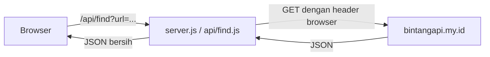

<div align="center">

# PRESETIN

**Cari preset Alight Motion dari link TikTok. Tempel link, langsung dapat link preset dan file XML-nya.**


[Channel WhatsApp](https://whatsapp.com/channel/0029VbDWBmtA89MamPba8q3f) · [Cara Pakai](#cara-pakai) · [Deploy](#deploy) · [Troubleshooting](#troubleshooting)

</div>

---

## Fitur

- Cari link preset Alight Motion yang tersembunyi di komentar video TikTok
- Hasil langsung tampil: link share Alight Motion dan file XML
- Pemutar video, caption, dan statistik supaya bisa dicek presetnya benar
- Tombol Paste, Cari, dan Reset yang praktis di HP
- Tampilan neo-brutalist yang responsif, dengan animasi shimmer
- Gratis dan tanpa login

## Cara pakai

1. Buka video TikTok, klik **Share**, lalu **Salin link**.
2. Tempel di kolom link PRESETIN, lalu klik **Cari**.
3. Klik **Buka di Alight Motion** atau **Download XML**.

## Menjalankan di komputer

Butuh [Node.js](https://nodejs.org) versi 16 ke atas.

```bash
npm install
npm start
```

Buka `http://localhost:3000`. Untuk ganti port:

```bash
PORT=8080 npm start
```

## Deploy

**Vercel**

1. Upload seluruh folder proyek ke GitHub.
2. Di [vercel.com/new](https://vercel.com/new), import repo tersebut.
3. Biarkan Root Directory dan Output Directory kosong, lalu klik **Deploy**.

`api/find.js` otomatis jadi endpoint `/api/find`, dan `vercel.json` mengatur batas waktu fungsi 30 detik.

**Railway, Render, atau VPS**

Deploy seluruh folder dengan start command `npm start`.

## Cara kerja



Halaman memanggil `/api/find` di server sendiri, lalu server meneruskan permintaan ke API pihak ketiga dengan header yang sama seperti script bot. Server juga membuang field `author` dan `creator` sebelum hasil dikirim ke browser.

## Struktur proyek

```
.
├── api/
│   └── find.js        # endpoint untuk Vercel
├── public/
│   ├── index.html     # kerangka halaman
│   ├── style.css      # semua tampilan
│   └── script.js      # logika cari, paste, reset, dan tampilan hasil
├── server.js          # server Express untuk hosting Node
├── vercel.json        # batas waktu fungsi Vercel
└── package.json
```

## Troubleshooting

**Muncul "File not found!" atau "not valid JSON"**

Halaman nggak menemukan server `/api/find`. Penyebab umum:

- `index.html` dibuka langsung atau di-upload ke hosting statis tanpa server. Jalankan `npm start`.
- Di Vercel, pastikan seluruh folder ikut ter-upload, bukan cuma `public/`.

**Pencarian lama atau timeout**

Pencarian bisa sampai 30 detik karena komentar video dipindai dulu. Di Vercel, pastikan `vercel.json` ikut ter-deploy.

**Video nggak mau diputar**

Link video dari TikTok kadang diblokir saat diputar di situs lain. Pakai tombol **Buka di TikTok** atau **Download video**.

## Catatan

Proyek ini bergantung ke API pihak ketiga, jadi bisa berhenti bekerja kapan saja kalau API-nya mati atau berubah.

## Kredit

- API: [bintangapi.my.id](https://bintangapi.my.id)
- Dibuat oleh **Malixx**
- Update dan info terbaru: [Channel WhatsApp](https://whatsapp.com/channel/0029VbDWBmtA89MamPba8q3f)
